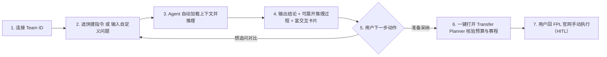
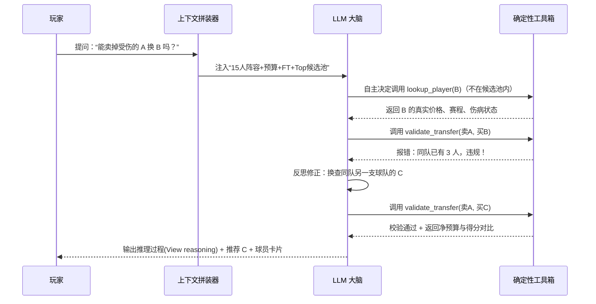

# FPL AI / Agent 竞品深度调研报告（2025～2026）

> **调研目标**：聚焦近两年以**大模型（LLM）+ 工具调用（Agent）**为核心的新一代 FPL AI 产品，深入拆解其**用户旅程、核心流程、功能模块、产品特点、预测准确度与商业模式**，为 **One Move** 的产品定位与差异化设计提供直接依据。
> **核心锚定标杆**：① **FPL Pulse（*The Gaffer's Pulse*）**（第三方真 Agent 标杆）；② **官方 FPL Companion**（大厂官方克制范式）；辅助参考 **FPL Copilot**。

---

## 1. 行业代际演进：从“规则求解器”到“AI Agent”

自 2024 年起，“FPL AI”相关搜索量增长约 3 倍，市场产品已明显分化为两代：

| 代际 | 代表产品 | 核心驱动力 | 典型体验与核心局限 |
| :--- | :--- | :--- | :--- |
| **第一代：传统规则 + ML 预测器**（简述） | Fantasy Football Hub、FPL Review、LiveFPL | 机器学习预测分（xPts）+ 线性规划求解器（Solver） | **本质是重度数据看板 + 数学最优化表格**。信息密度极高，不会听人话、无法响应突发文字新闻与个人偏好，普通玩家学习门槛极高。 |
| **第二代：大模型 + 工具调用 Agent**（重点调研） | **FPL Pulse（The Gaffer's Pulse）**、**FPL Companion（官方）**、**FPL Copilot** | **LLM 大模型（推理与交互）+ 实时球队上下文 + 预测/规则/模拟工具箱** | 能读取 `Team ID` 上下文、自主调工具查数、结合自然语言追问与非结构化情报给出个性化建议，并用富交互卡片承载结果。 |

---

## 2. 深度拆解标杆 ①：FPL Pulse（*The Gaffer's Pulse*）

> **一句话定位**：目前市面上功能最完整、工程与产品设计最贴近**“真 Agent + 确定性工具护栏”**的第三方标杆产品。

### 2.1 规模、定位与商业模式
- **目标人群**：希望用 AI 节省每周研究时间、同时追求 Mini-League 胜率的活跃玩家。
- **产品形态**：全功能 Web 工作台（移动端适配良好）+ 内嵌上下文感知 AI 助手 *The Gaffer's Pulse*。
- **商业模式（Freemium）**：
  - **免费版**：实时积分、Mini-League 追踪、价格预测、下轮预测分（Next-GW xP）、**每日最多 3 次** 4 个预设快捷指令（Quick Prompts）。
  - **Pro 版（£2.99/月 或 £24.99/年，7 天免费试用）**：解锁无限自定义自然语言追问、未来 5 轮预测分、首发概率（Start %）、竞争对手感知（Rivals）、Reddit 社区情绪、无限次蒙特卡洛模拟。

### 2.2 核心用户旅程与后台 Agent 执行流程

**后台 Agent 的 4 步核心执行流（官方公开机制）：**
1. **Context & Data Loading（上下文加载 + 按需查库）**：打开对话时自动注入用户 15 人阵容、银行余额、FT 数量，以及各位置未来 3 轮预测分 Top 候选池。**关键细节**：当用户追问候选池之外的球员时，AI **不会靠预训练记忆瞎编，而是主动调用查询工具去拉真实数据**。
2. **Rule Validation（硬规则校验）**：所有换人建议强制经过确定性规则检查（同队 ≤ 3 人、预算不超、2/5/5/3 阵型合法、排除确定伤停球员）。
3. **Fixture Analysis（攻防赛程量化）**：用相对联盟均值 `1.00` 的攻防系数评估赛程（如 `ATT 1.50` 代表进攻赛程比均值好 50%，`DEF 0.60` 代表零封概率高 40%）。
4. **Transparent Reasoning（透明推理输出）**：结论上方提供可折叠的 **`View reasoning`** 模块，完整展示 AI 在给出答案前是如何对比备选、权衡利弊的。

### 2.3 核心功能模块细分

| 模块分类 | 具体功能 | 解决什么问题 | 免费 / Pro |
| :--- | :--- | :--- | :--- |
| **AI 决策入口** | 4 大快捷指令（队长 / 转会 / 替补顺位 / 全队体检）+ 自定义追问 | 降低新手提问门槛，覆盖每周 90% 高频决策 | 快捷限次免费 / 自定义 Pro |
| **富交互回答卡片** | 球员卡片（价/持有率/伤病/Start%/xP）、双人雷达对比图、5 轮赛程色块条、`Open in Planner` 按钮 | 解决“纯文字长回复在截止前看不下去、没法直接核对”的痛点 | 基础免费 / 详情 Pro |
| **预测与概率引擎** | Next-GW / 5-GW 预测分、**Start %（首发概率模型）**、DefCon 防守贡献追踪 | 识别“名义上能踢但第 55 分钟被换下”的轮换陷阱，适配新规 | 1 周免费 / 5 周与 Start% Pro |
| **博弈与舆情增强** | **Rivals（最多绑定 5 个同联赛对手）**、**Reddit 社区情绪分析（r/FantasyPL）** | 回答“落后对手时该选稳健队长还是赌奇兵”；提前发现恐慌抛售 | 追踪免费 / 进 AI 上下文 Pro |
| **联赛模拟器** | 10,000+ 次蒙特卡洛赛季模拟 | 量化夺冠/前三概率，辅助判断风险偏好与芯片时机 | Pro 无限次 |

### 2.4 产品特点优势与诚实短板
- **核心优势**：
  1. **非纯聊天框**：把对话结果无缝结构化为卡片、雷达图和 Planner 跳转，兼顾灵活性与可读性。
  2. **透明可信**：`View reasoning` 展示推理过程 + **Graded Predictions（每周赛后公开将模型预测分与官方 xP 和实际得分对比打分）**，用评测建立信任。
  3. **懂最新规则**：原生支持 2025/26～2026/27 的 5 FT 累积、两套芯片和 DefCon（CBIT/CBIRT +2 分）。
- **明确短板（官方坦承）**：
  1. 临场伤停新闻通常比官方发布会滞后 **2~3 小时**（Deadline 前最后 1 小时仍需人肉复核）；
  2. 无法预测换帅、突发变阵或单场 15+ 分的偶发爆发（Outlier hauls）；
  3. 对“Rivals 对手阵容”的感知存在规则限制——赛前官方隐藏他人阵容，只能看上一轮快照。

---

## 3. 深度拆解标杆 ②：FPL Companion（英超官方 × Microsoft AI）

> **一句话定位**：背靠 **1,130 万+ 官方玩家基本盘**，代表“大厂官方对 AI 辅助决策边界的极度克制”。

### 3.1 规模、底座与流程
- **用户规模与入口**：直接内嵌于英超官方 Fantasy App / 网页端，面向全量玩家免费开放。
- **数据与知识底座**：基于微软 Azure / OpenAI 技术，接入 **30+ 赛季历史统计、9,000+ 官方视频、300,000+ 篇文章**，并与每周赛前发布会、官方伤病更新实时联动（官方举例：周二问和周四问同一个问题，会因周中发布会新闻变化而返回不同建议）。

### 3.2 功能特点与“刻意不做”的哲学
- **核心能力**：结合用户当前球队状态与官方实时新闻，针对伤停替代、赛程对比、规则疑问提供多维数据参考与相关官方深度文章链接。
- **刻意克制的边界（官方高级游戏经理 Andy Selby 明确表态）**：
  1. **绝不预测球员得分（No Points Prediction）**：官方认为足球充满不可预测性，不给具体预测分数字。
  2. **绝不替用户拍板或自动托管（No Autopilot）**：永远只给 **2~3 个有数据支撑的备选方向**（例如“伤了可以看看 Palmer、Saka 或 Semenyo”），把最终决定权 100% 留给玩家。
- **迭代方式**：通过分析全量用户的提问热点与追问路径（Follow-up questions），持续优化数据召回和回答准确度。

---

## 4. 辅助参考：FPL Copilot（fplcopilot.com）

- **定位**：主打“全免费 + 极低上手门槛”的 AI 规划与对话工具。
- **值得借鉴的交互细节**：
  1. **Team ID 零门槛提取**：输入框支持**直接粘贴官方 Gameweek History 完整 URL**，系统自动提取 `/entry/数字/` 中的 Team ID，解决新手找不到 ID 的痛点。
  2. **球场可视化 + 多路径 Solver + 无限对话**：首页直接渲染 15 人球场阵型图（带每名球员 xPts 与伤病百分比，如 `Raya 50%`），支持对比 `2 Paths / 8 GW` 长线转会路线，并在侧边提供无消息上限的 Copilot 对话解释每一步选择（包括“是否值得扣 -4 分”）。

---

## 5. Agent 架构与能力深度透视（看懂竞品 Agent 到底怎么跑）

对于第一次做 Agent 产品的 PM，最容易困惑的是：**“竞品页面看起来像网页+聊天框，后台的 Agent 到底在干嘛？”** 下面对照业界标准的 **Agent 六大构件**，拆解 *FPL Pulse* 等标杆竞品的真实运转机制：

### 5.1 竞品 Agent 的 6 个关键工程与产品设计
1. **上下文管理（Context Management）—— 不是把全英超塞给模型**
   - 如果把 600+ 球员全塞进 Prompt，模型既贵又容易看花眼（注意力分散）。
   - *FPL Pulse* 的做法是：**开局只注入“你的 15 人 + 预算/FT + 各位置 Top 候选短名单”**；只有当你问到名单外的人时，才由 Agent **按需调工具去查**。
2. **工具契约与护栏（Tools & Guardrails）—— 决定 Agent 能不能干活**
   - 竞品给大模型配的不是“万能搜索”，而是职责单一的确定性小工具：`查球员详情`、`校验转会合法性`、`算赛程攻防系数`、`查对手持仓`。
   - **关键细节**：工具报错必须说人话（如 *“超预算 £0.3m”*），Agent 才能看懂报错并**自我修正**换下一个候选人。
3. **推理透明化（Reasoning Trace）—— 解决“黑盒不信任”**
   - Agent 思考过程如果全藏在后台，用户看到一个结果会怀疑“你是不是瞎猜的”。*FPL Pulse* 的 `View reasoning` 把“我先看了谁、排除了谁、为什么选这个”折叠展示，是极高性价比的信任设计。
4. **结构化输出 → 前端富卡片（Structured Output）**
   - 好的 Agent 不只吐一大段 Markdown 文字，而是让模型输出带**球员 ID / 动作类型**的结构化数据，前端据此渲染出**球员卡、雷达图、一键进 Planner 按钮**，把“对话”变成“可操作的界面”。
5. **结构化状态（State）vs 长期记忆（Memory）**
   - FPL 竞品**不把聊天记录当长期记忆**，因为每周阵容和伤病都在变。真正的“记忆”是**每周重新拉取的官方球队快照 + 用户手动配置的目标（如 5 个 Rivals）**。
6. **HITL 与评测（Evals）**
   - 官方 *Companion* 靠“只给多选不拍板”守住 HITL；*FPL Pulse* 靠“赛后把预测分和实际得分公开对比（Graded）”建立评测闭环。

### 5.2 当前竞品 Agent 普遍存在的 3 个短板（我们的突破口）
1. **多轮冲突处理偏弱**：多数竞品偏“一问一答”，当用户提出相互打架的约束（如“既要留 A、又要下周买 B、还不能扣 4 分”）时，很少能**主动多轮试错并指出具体哪条约束冲突**。
2. **突发新闻响应慢 2~3 小时**：第三方工具依赖定时抓新闻，Deadline 前突发伤停来不及更新；缺少**“用户贴一段刚看到的发布会文字，Agent 现场改写风险并重演”**的即时闭环。
3. **只测预测分，不测 Agent 本身**：竞品会公布预测分准不准，但很少有系统化的 **Agent Evals** 去测“听懂约束的准确率、工具报错后的自修正成功率、解释数字与工具结果是否 100% 一致（防幻觉）”。

---

## 6. 竞品横向对比矩阵

| 对比维度 | FPL Pulse（Gaffer's Pulse） | 官方 FPL Companion | FPL Copilot | **One Move（我们的定位）** |
| :--- | :--- | :--- | :--- | :--- |
| **核心产品定位** | 全能型 AI 决策工作台 + 助手 | 官方百科 + 数据辅助对话 | 免费多周 Solver + 聊天助手 | **聚焦赛前最后一公里的“唯一决策”工作台** |
| **决策收敛度** | 中（给推荐 + 多备选对比） | 低（刻意只给发散选项，不拍板） | 中（给多路径方案） | **高（Agent 权衡后拍板唯一主推 + 备选对比）** |
| **“不动”的地位** | 提及保留 FT，但未作为一等核心 | 不主动做 Hold vs Hit 权衡 | 偏重规划未来转会路径 | **平等一等公民，显式权衡 FT 机会价值** |
| **Agent 自主性** | 强（自动载入+按需查库+规则校验+展示推理） | 中（新闻/知识检索 + 球队上下文） | 弱（主要是前端 Solver 算完 + LLM 解释） | **强（自主诊断 + 工具编排 + 校验失败自我修正）** |
| **赛前新闻接入** | 滞后 2~3 小时 + Reddit 舆情 | 官方实时发布会（强壁垒） | 依赖 API 伤病状态 | **Phase 1 支持用户粘贴突发新闻即时重演** |
| **效果评测与复盘** | **每周公开预测分对比（Graded）** | 后台埋点看用户追问率 | 无公开评测闭环 | **离线回放集（Evals）+ 个人赛后采纳复盘双轨** |

---

## 7. 对 One Move 的核心产品启示（抄什么 vs 避什么）

1. **必须借鉴的好设计**：
   - **入口细节（学 FPL Copilot）**：支持直接粘贴官方 URL 自动抠出 `Team ID`，彻底消除新手寻找 ID 的障碍。
   - **透明推理（学 FPL Pulse）**：工作台必须有类似 `View reasoning` 的推理过程展开区，让用户看到 Agent 调了什么工具、对比了哪些备选（包括“不动”）、为什么被规则驳回又改了什么方案。
   - **工作台卡片 + 追问联动（学 FPL Pulse）**：用“球队体检卡 + 预算/FT/扣分状态条 + 主推决策卡”承载结构化事实，聊天/输入框只负责 **What-if 假设追问** 与 **粘贴突发新闻**。
   - **诚实评测（学 FPL Pulse Graded Predictions）**：不吹嘘预测神准，通过“离线回放基准线”和“每周赛后实际得分复盘”证明 Agent 的真实价值。
2. **刻意避开的坑（Phase 1 克制边界）**：
   - **不学 FPL Pulse 做大而全**：不做万次蒙特卡洛模拟、不做全网 Reddit 爬虫、不做账号收费体系。
   - **不学官方 Companion 只给发散选项**：官方因为品牌中立不敢替玩家做主；而 **One Move** 的核心价值正是帮纠结的玩家收敛出**逻辑最通顺、算账最清楚的唯一行动建议**（同时严守 HITL，绝不自动提交）。
   - **补上竞品普遍缺失的一环**：竞品很少支持**“我贴一段刚刚看到的发布会新闻 + 加一句个人约束，Agent 现场推翻重算并解释变化”**，这正是我们凸显真 Agent 能力与评测价值的绝佳差异化场景。
