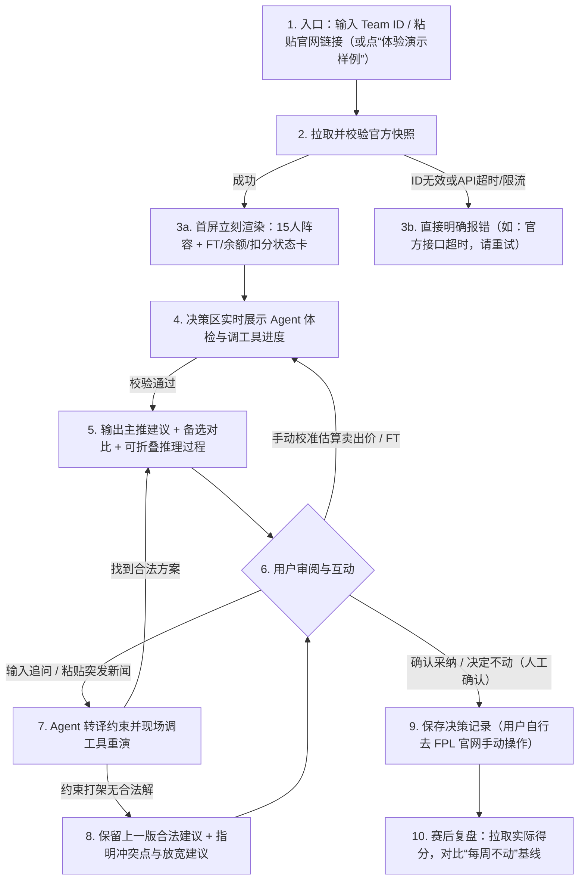
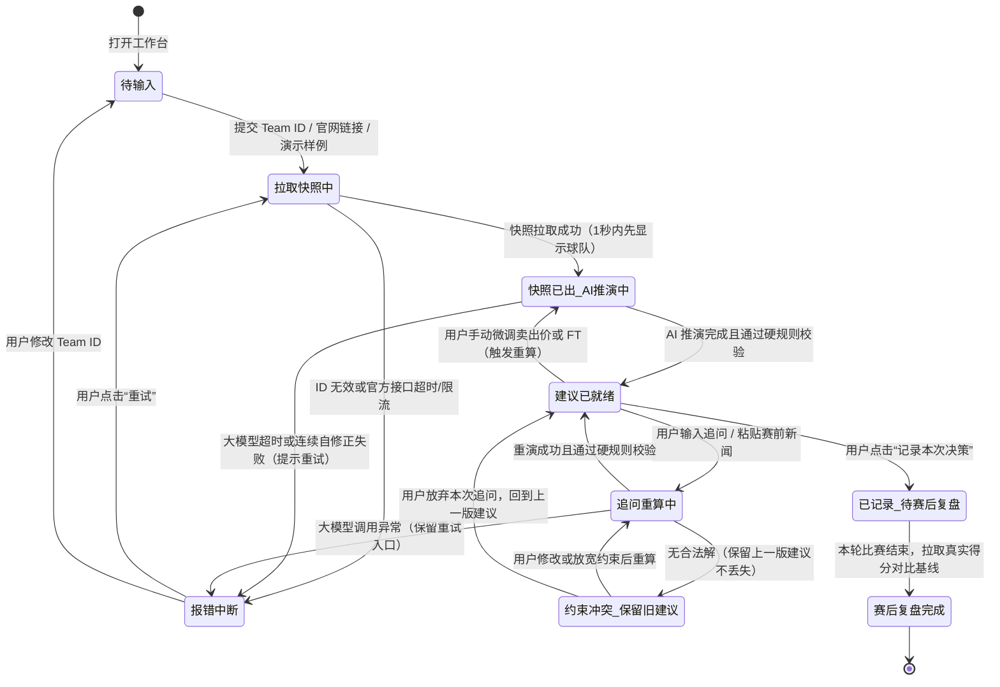

# One Move — 核心用户流程与状态机（Phase 0.2 · v0.2）

> **状态**：已按反馈简化，待用户核对确认
> **前置基线**：[01-product-one-pager.md](file:///home/antigravity/nikkuta/FPL/docs/01-product-one-pager.md)（v0.3）

---

## 1. 端到端核心用户旅程（渐进式加载 + 真 Agent 闭环）

为了避免“打开工作台就是整页转圈加载”，首屏采用**两段式渐进渲染**：**0.5 秒内先出球队快照与状态卡**，同时在决策区**实时展示 Agent 思考与调工具进度**。

---

## 2. 工作台状态机（全中文状态对照）

---

## 3. 关键状态与异常流转明细（工程可靠性验收口径）

| 场景 / 状态 | 触发条件 | 系统确定性动作 | 用户界面表现 |
| :--- | :--- | :--- | :--- |
| **渐进式首屏** | 提交有效 `Team ID` | 先返回快照数据；异步启动 Agent 推演（带防重复提交锁） | 立刻显示 15 人阵容、银行余额、从真实建队轮次推算的 FT；决策区实时显示“正在体检 → 查候选 → 验规则” |
| **官方 API 异常 / 超时** | 无效 ID、超时、503 维护或限流 | 直接中止本次加载，**不擅自切换样例球队**（避免数据张冠李戴） | 清晰报错提示（如“官方接口超时或 ID 不存在”），提供 **“重试”** 按钮与修改 ID 入口 |
| **卖出价 / FT 手动校准** | 用户觉得估算卖出价或 FT 与官网不一致 | 更新当前会话快照中的校准值，自动触发重算 | 原建议标记“数据已更新，重算中”，数秒后刷新为基于校准值的新建议 |
| **约束冲突无解** | 用户追加互相打架的约束（如预算差 £1.2m 且不让卖核心） | 确定性校验器拦截所有非法组合；Agent 停止试错，**严禁拼凑非法方案** | **保留上一版合法建议不变**，明确指出“哪两条约束冲突”并给出 1~2 个放宽提示 |
| **大模型输出异常 / 超时** | 模型返回非法格式、数字与工具冲突、或超时 | 触发最多 1~2 次带报错信息的自动重试；仍失败则熔断报错 | 提示“AI 本次推理异常，已拦截不可靠输出”，提供“一键重试”按钮，绝不展示未校验的数字 |
| **防重复点击（幂等）** | 用户在推演中连续狂点“生成/重算” | 锁定进行中的请求，丢弃或复用结果 | 按钮置灰防抖，避免重复扣费与状态错乱 |
| **人工确认与赛后复盘** | 用户点击“我已采纳 / 决定不动” | 保存当时快照、主推建议、用户实际选择与当前轮次 | 赛后打开复盘页，自动拉取该轮真实球员得分，对比“每周不动”基线展示盈亏 |
