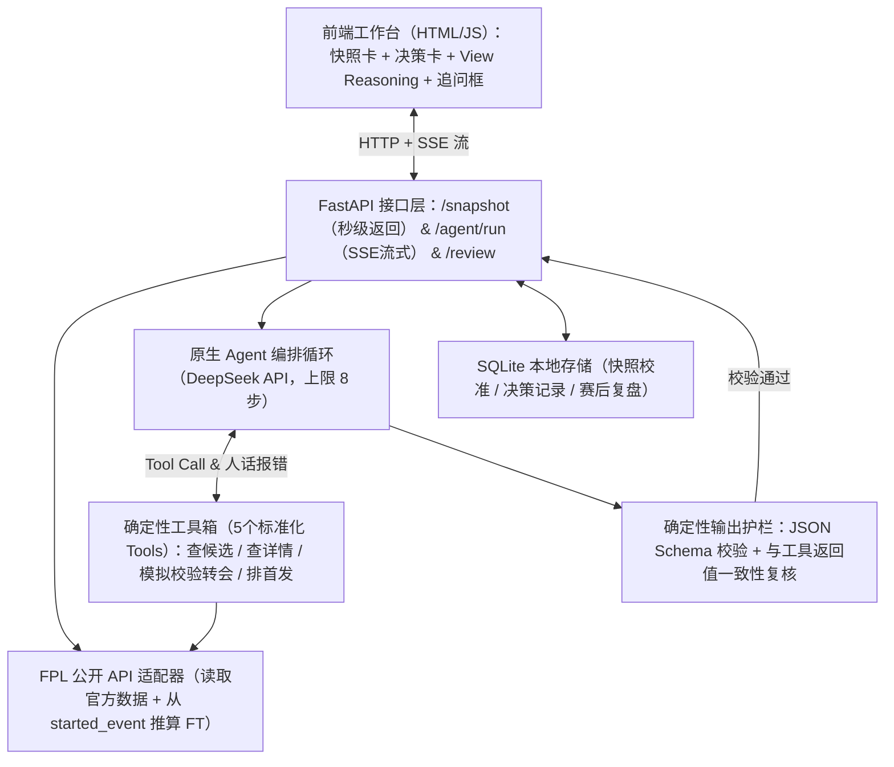

# One Move — 系统架构、边界与关键数据对象（Phase 0.3）

> **状态**：已起草，待用户核对确认
> **前置基线**：[01-product-one-pager.md](file:///home/antigravity/nikkuta/FPL/docs/01-product-one-pager.md)（v0.3）、[02-user-flow-and-state-machine.md](file:///home/antigravity/nikkuta/FPL/docs/02-user-flow-and-state-machine.md)（v0.2）

---

## 1. 总体技术选型（Phase 1 已拍板）

| 层级 | 选型方案 | 选型理由（兼顾产品体验与 PM 掌控力） |
| :--- | :--- | :--- |
| **前端工作台** | **极简单页 HTML / JS**（支持 SSE 流式接收） | 完美实现“0.5s 先出球队快照 + 决策区实时流式显示 Agent 步骤”，不折腾 React/Node 复杂工程 |
| **后端与编排** | **Python + FastAPI + 原生轻量 Tool-Calling 循环** | 零黑盒框架（不用 LangGraph），步数熔断（上限 8 步）、报错重试、Trace 日志一目了然，极易做走查与 Evals |
| **大模型接口** | **统一 OpenAI 兼容协议（默认 DeepSeek API）** | 性价比高、Tool-Calling 稳定；后续跑 Evals 可零改代码横向对比不同模型 |
| **本地存储** | **SQLite（单文件数据库）** | 零配置保存球队校准值、历史决策记录、赛后复盘与离线评测数据 |

---

## 2. 系统分层架构与调用链



---

## 3. 上下文工程（Context Engineering）：喂给 Agent 什么？

严守“**只喂最小充分集，绝不把 600+ 球员原始 70 字段 JSON 全塞给大模型**”原则：

1. **开局常驻上下文（精简快照，每次必带）**：
   - **球队账本**：当前轮次 `gw`、银行余额 `bank`、推算（或已校准）`free_transfers`、可用芯片概览。
   - **15 人精简清单**：仅保留 `id / 姓名 / 球队 / 位置 / 卖出价(标明是否估算) / 伤病概率与新闻 / 近况 Form / 场均分 PPG / 未来3轮赛程难度 FDR / 是否首发与队长`。
2. **按需注入上下文（仅当用户触发时加入）**：
   - 用户粘贴的突发赛前新闻文本；
   - 用户的自然语言 What-if 追问或约束条件。
3. **绝不直接塞入，必须通过工具按需查询**：
   - 全英超 600+ 候选球员数据、单名球员最近 5 轮详细战绩与 DefCon 达标情况。

---

## 4. Agent 工具箱契约（5 个确定性 Tools）

Agent 大脑通过调用以下 5 个工具完成“自主体检 → 找候选 → 试错验证 → 排阵拍板”：

| 工具名称 | 输入参数 | 确定性输出 / 核心作用 | 错误返回设计（供 AI 自我修正） |
| :--- | :--- | :--- | :--- |
| **`search_transfer_candidates`** | `position`（位置）、`max_price`（最高价）、`exclude_teams`（可选） | 从官方池过滤掉伤停与不可用球员，按状态/赛程返回 **Top 10 合法候选人精简信息** | 若价格过低找不到人，返回：`当前预算 £X.Xm 无可用人选，请提高预算或考虑降级其他位置` |
| **`get_player_detail`** | `player_id` 或 `player_name` | 返回该球员近 5 轮得分、出场分钟、DefCon（CBIT/CBIRT）表现、未来 5 轮对手与 FDR | 若名字模糊（如重名），返回：`匹配到多个球员：[列表+ID]，请指定准确 player_id` |
| **`simulate_and_validate_move`** | `action_type`（`hold` / `lineup_only` / `transfer_1` / `transfer_2`）、`out_ids`、`in_ids` | **核心护栏工具**：硬校验预算、FT 与 -4 罚分、同队 ≤ 3 人、2/5/5/3 配额；同时返回基线参考净收益与保留 FT 机会价值 | 违规时返回明确人话报错，如：`校验失败：阿森纳已有3人，无法再买萨卡` 或 `超预算 £0.3m` |
| **`suggest_best_lineup`** | `squad_15_ids`（15 人阵容）、`risk_notes`（可选伤停提示） | 确定性算出满足“≥1门将、≥3后卫、≥1前锋”的最优 11 人首发、替补顺位及队长/副队长 | 若传入人数不为 15 或位置配额错误，返回具体缺失位置提示 |
| **`evaluate_hold_baseline`** | 当前 15 人快照 | 专用于评估“本周完全不动 / 仅调阵”的预期表现与保留 1 个 FT 的多轮期权参考值，确保“不动”平等参与比较 | — |

---

## 5. 防幻觉与受控执行护栏（Guardrails）

1. **Tool-Calling 循环的 3 种结束条件**：
   - **正常结束**：AI 认为信息充分，不再发出工具调用指令，直接按约定 JSON Schema 输出最终建议，**且通过下述确定性护栏校验**。
   - **护栏拦截（不准结束）**：AI 试图交卷但未过校验时，护栏将具体报错退回给 AI 逼其继续修正（最多补救 **2 次**）。
   - **步数与超时熔断**：单次推演最多允许 **8 轮** 工具调用，超步数或超时立即强制刹车报错，防止死循环。
2. **必须过校验才准推荐**：Agent 最终拍板推荐的转会/调阵方案，**必须在本次对话轨迹中实际调用过 `simulate_and_validate_move` 且返回 `valid = true`**，否则护栏直接拦截。
3. **原生结构化输出 + 确定性代码复核（非 AI 核对 AI）**：
   - 调用 DeepSeek API 时直接开启原生结构化输出（JSON Mode / Schema），让模型**一步交出**包含“结构化数字字段（价格、FT、扣分）+ 理由文本”的 JSON，而非先写散文再二次提取。
   - **100% 由确定性 Python 代码核对**：代码拿 JSON 里的结构化字段与最近一次工具返回的真实数据做精确比对（且前端卡片数字直接取自校验后的结构化字段）。若发现不一致，直接拦截并带报错自动重试，绝不把幻觉数字展示给用户。

---

## 6. 关键数据对象（Data Models）

1. **`TeamSnapshot`（球队快照）**
   - `team_id`、`gw`、`started_event`（真实建队轮次，用于准确推算 FT）
   - `bank`（银行余额）、`free_transfers`（推算 FT）、`ft_is_calibrated`（是否人工校准）
   - `players[15]`：每名球员含 `id, name, team, pos, now_cost, selling_price, price_is_estimated, status, chance_of_playing, form, ppg, next_3_fdr`
2. **`DecisionRunRecord`（单次决策与追溯记录，存 SQLite）**
   - `run_id`、`team_id`、`gw`、`created_at`
   - `user_constraints`（追问约束文本）、`pasted_news`（粘贴的突发新闻）
   - `reasoning_trace`（完整工具调用与 AI 思考轨迹，供 `View Reasoning` 与离线 Evals 审计）
   - `recommendation`（结构化主推方案 + 备选方案）
   - `user_action`（HITL 确认状态：`pending` / `adopted_move` / `adopted_hold` / `ignored`）
3. **`PostGWReview`（赛后复盘记录，存 SQLite）**
   - `run_id`、`gw`、`actual_points`（用户实际得分）、`hold_baseline_points`（如果本周不动的对照得分）、`delta`（盈亏差）、`bad_case_tag`（人工标注复盘标签）

---

## 7. 规划目录结构（Phase 1 预览，暂未生成代码）

```text
FPL/
├── docs/                  # 产品、调研、流程、架构与进度文档
├── backend/
│   ├── main.py            # FastAPI 入口与 SSE 流式接口
│   ├── fpl_client.py      # FPL 公开 API 拉取与 FT/卖出价计算
│   ├── tools.py           # 5 个确定性工具与硬规则校验器
│   ├── agent.py           # 原生 Tool-Calling 循环与护栏复核
│   ├── models.py          # 核心数据对象（Pydantic）
│   └── storage.py         # SQLite 持久化（决策与复盘）
├── frontend/
│   └── index.html         # 轻量单页工作台（渐进加载 + 推理折叠 + 复盘）
├── evals/                 # Phase 1.2 离线回放评测集与评测脚本
└── tests/                 # 规则校验与异常注入单元测试
```
