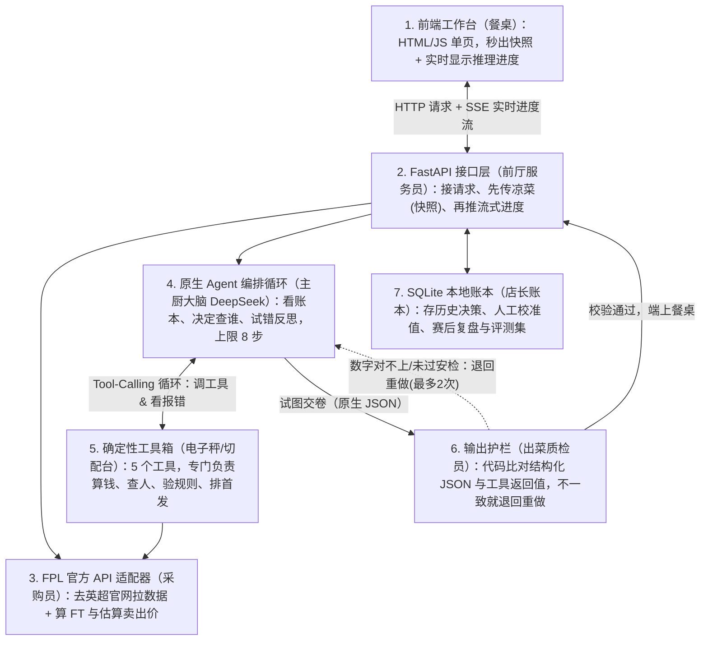

# One Move — 系统架构与 Agent 原理详解（零基础完整独立版）

> **阅读说明**：这是一份**完全独立、不依赖任何前置文档**的架构精讲文档。无论你是否看过工程版设计文档，只要顺着这一份往下看，就能彻底看懂 **One Move** 的系统全貌、Agent 到底是怎么跑起来的、以及每一步为什么这样设计。

---

## 一、先搞懂背景：我们要造一个什么系统？

**One Move** 是一个面向英超范特西（FPL）玩家的赛前决策工作台。你只需要输入自己的公开 `Team ID`（不用登录官方账号密码），系统就会：
1. **1 秒内**拉取你当前 15 名球员、银行余额、可用免费转会次数（FT），让你先看到球队现状；
2. **紧接着**由后台的 **AI Agent（以 DeepSeek 大模型为大脑）** 自主体检你的球队、调用工具查候选球员和赛程、用硬规则校验合法性，最后给你一个**逻辑通顺、100% 合法的本周最优建议**（包括“建议这周不动”）；
3. 支持你用自然语言追问（比如“*如果我不想卖哈兰德，下周攒钱买萨卡呢？*”）或粘贴赛前突发新闻，让 Agent 现场重新推演。

---

## 二、核心技术选型与 8 个高频概念（大白话版）

在看架构图之前，先把文档里会出现的技术名词一次讲透：

| 概念 | 大白话是什么意思 | 它解决什么问题 | 如果不用它，会出什么事 |
| :--- | :--- | :--- | :--- |
| **Tool-Calling** （工具调用） | 给只会“张嘴聊天”的大模型配一个“计算器和资料库”，教它需要查数或算钱时**伸手按工具** | 让 AI 能查到实时球员数据、能精准算预算与规则 | 大模型只能靠脑子瞎猜球员身价和赛程，**100% 产生幻觉** |
| **原生轻量循环** （Native Loop） | 不装第三方复杂 Agent 框架，直接用 Python 官方基础库（`openai` SDK）写一个“发给 AI → AI 调工具 → 还给 AI”的 `while` 循环 | **零黑盒**：每一步调了什么工具、报了什么错，一眼就能看清并排查 | 若盲目上重型框架（如 LangGraph），出 Bug 时分不清是自己写错还是框架有坑 |
| **LangGraph** | 别人写好的大型“多智能体自动化流水线框架” | 适合好几个 AI 互相辩论、或跑一半暂停 3 天等人审批的复杂大系统 | Phase 1 单 Agent 场景属于杀鸡用牛刀，增加维护与学习黑盒 |
| **上限 8 步** （熔断机制） | 上面的“AI 调工具 → 看结果 → 再想”循环，**最多只准转 8 圈** | 防止 AI 遇到无解情况时陷入“死循环” | AI 反复试错 100 次，把 API 费用烧光、页面转圈 2 分钟卡死 |
| **SSE 流式输出** | 像 ChatGPT 一个字一个字往外蹦一样，后端每跑完一步就**实时推一行进度到网页** | 避免用户干等 8 秒空白转圈，同时让用户亲眼看到 Agent 在一步步思考 | 页面长时间白屏转圈，用户体验差，且感觉不到 Agent 的推理过程 |
| **原生结构化输出 + 代码规则复核** | 让 DeepSeek **直接按固定 JSON 表格交卷**，再由 **Python 代码（不是另一个 AI）** 核对表格里的数字与工具返回是否一致 | 让前端能精准画出球员卡片，且**彻底封杀 AI 偷改价格/扣分的幻觉** | AI 写一大段散文没法渲染成卡片，或者把 £10.2m 瞎写成 £10.0m |
| **Evals** （Agent 评测） | AI 产品的 **“标准化考卷 + 质检体系”**（分历史快照离线回放 + 赛后真实得分复盘） | 每次改完 Prompt 或换模型，一键重考算出客观分数（如约束遵守率、防幻觉率） | 改了这头坏了那头，完全靠人工感觉盲猜“好像变聪明了” |
| **FastAPI / SQLite / Pydantic** | **FastAPI**=后台服务框架；**SQLite**=本地单文件小账本数据库；**Pydantic**=数据格式安检门 | 用最轻的工程成本把网页、AI、本地存储串起来 | 引入重型数据库和复杂前端工程，维护成本飙升 |

---

## 三、系统全貌：完整架构图 + “餐厅后厨”类比

为了让你不看其他文档也能看懂，这里直接附上完整系统架构图，并用“一家餐厅”来一一对照解释：

**顺着图走一遍 7 个角色的职责：**
1. **前端工作台（餐桌）**：你打开的网页。上面展示球队 15 人、余额、FT，下面展示主推建议、可折叠的推理过程（`View Reasoning`）和追问输入框。
2. **FastAPI 接口层（前厅服务员）**：接收网页发来的 `Team ID`。为了让用户不用干等，服务员先把采购员 1 秒拉回来的“球队快照”端上桌，同时通知后厨主厨开始做菜，并把后厨每一步动作通过 SSE 实时播报给你。
3. **FPL 官方 API 适配器（采购员）**：去英超官网（`fantasy.premierleague.com`）拿最新数据。官方接口直接提供了球员身价、状态、伤病、赛程；只有**“当前有几个 FT”**和**“估算卖出价”**两个数字需要采购员顺手按规则算出来（其中 FT 必须从你的真实建队轮次 `started_event` 开始算，不能像某些竞品那样傻傻从第 1 轮算起）。
4. **原生 Agent 循环（主厨大脑 DeepSeek）**：真正做决策的大脑。它自己决定查哪几个球员、提出什么换人假设、撞墙报错了怎么改方案。
5. **5 个确定性工具箱（电子秤 / 切配台）**：主厨**绝对不自己心算**，任何算钱、查规则、查赛程、排阵都必须按铃叫工具算。
6. **输出护栏（出菜质检员）**：主厨交卷前，质检员拿代码检查两件事（下文第五节详讲），不合规定直接打回厨房重做。
7. **SQLite（店长账本）**：记下你校准过的卖出价/FT、每次推荐了什么、你采纳没、周末英超踢完后实际拿了多少分。

---

## 四、Agent 的核心本质：Tool-Calling 循环到底怎么转？什么时候结束？

剥掉所有花哨包装，单 Agent 的内核就是一个 **`while` 循环**：
`把问题和工具说明书给 AI → AI 决定调工具 → 代码跑完把结果还给 AI → AI 继续想` …… 如此反复。

### 4.1 用你的真实球队跑一遍完整实例
假设你输入了 `yang's Team`（第 12 轮，银行余额 `£7.9m`，`1 FT`，中场 `Iroegbunam` 标红受伤）：

- **第 0 步：给主厨递“精简账本”（上下文工程）**
  我们**绝对不把全英超 600 个球员（每人 70 多个字段）塞给 DeepSeek**，只递一张精简账本：
  - 账户状态：`第 12 轮 | 银行 £7.9m | 1 FT | 芯片均可用`
  - 15 人清单：每人只保留 10 个核心字段（`id / 姓名 / 球队 / 位置 / 估算卖出价 / 伤病概率与新闻 / 近况 Form / 场均分 PPG / 未来3轮难度 FDR / 是否首发队长`）。
- **第 1 圈（算不动基准 + 找候选）**：
  - DeepSeek 先调用 `evaluate_hold_baseline`，算出“这周完全不动、省下 1 个 FT”能拿多少参考分；
  - 接着看到你中场有伤员且银行有闲钱，调用 `search_transfer_candidates(位置=中场, 最高预算=12.4)`，工具自动过滤掉伤停和同队已满 3 人的球队，只返回 Top 10 买得起的中场（比如 Saka、Palmer、Rogers）。
- **第 2 圈（点名深挖）**：
  - DeepSeek 想对比其中两人，调用 `get_player_detail("Saka")` 和 `get_player_detail("Rogers")`，拿到近 5 轮得分、DefCon 防守贡献达标率、未来 5 轮对手。
- **第 3 圈（试错与自我修正 —— 最体现“真 Agent”的一步）**：
  - 假设 DeepSeek 一开始想买某个阿森纳球员 B，调用 `simulate_and_validate_move(卖=Iroegbunam, 买=B)`；
  - 工具拦住并吐出人话报错：`校验失败：阿森纳已有 3 人，不能再买！`
  - **DeepSeek 看到报错后自己反思换思路**，改测 `simulate_and_validate_move(卖=Iroegbunam, 买=Palmer)` → 校验通过！工具返回：`合法，花费 £X.Xm，剩 0 FT，扣 0 分`。
- **第 4 圈（配套排阵 + 交卷）**：
  - DeepSeek 调用 `suggest_best_lineup`，拿到换人后最优的 11 人首发、替补顺位和队长；
  - 信息全部凑齐后，DeepSeek **不再发出调工具指令**，直接按固定 JSON 表格交卷。

### 4.2 这个循环什么时候结束？谁说了算？
不是全由 AI 自己说了算，而是 **3 种出口**：
1. **正常结束（AI 交卷 + 通过质检）**：AI 这一圈不再调用工具，直接吐出最终 JSON 建议，且通过了输出护栏安检，循环正常退出。
2. **护栏拦截（AI 以为结束了，但代码不让它结束）**：万一 AI 偷懒没过 `simulate_and_validate_move` 就想瞎编交卷，或者数字对不上，**代码护栏会直接拒绝结束循环**，把报错退回给 AI 逼它再跑一圈修改（最多补救 2 次）。
3. **强制刹车（上限 8 步熔断）**：如果转满了 **8 圈** AI 还在不停调工具，代码直接拉闸终止并报错提示重试，绝不让它陷入死循环烧钱。

---

## 五、重点拆解：“原生结构化输出 + 代码规则复核”到底是怎么回事？

很多刚接触 Agent 的 PM 会以为这里需要两步：*“先让 AI 写一段散文，再让另一个 AI 把它转成 JSON，然后再去核对”*——**其实不用那么麻烦！**

真实工程里的流程更干净，分两步：
1. **第 1 步（一步直接交结构化表格）**：
   - 现在的 DeepSeek 等大模型 API 原生支持 **Structured Outputs / JSON Mode**。我们在发请求时就把固定表格模板（JSON Schema）一起发过去。
   - 所以 DeepSeek 交卷出来的**第一手结果就已经是一个干净的 JSON 对象**，里面同时包含：
     - **结构化数字字段**：如 `action_type: "transfer_1"`, `out_id: 102`, `in_id: 19`, `cost: 10.2`, `remaining_ft: 0`, `hit_points: 0`；
     - **给人看的文本字段**：如 `reason_summary: "建议用 £10.2m 买进萨卡替代伤员，本次免费不扣分。"`
2. **第 2 步（100% 由确定性 Python 代码核对，绝不用 AI 核对 AI）**：
   - 为什么不用另一个 AI 核对？因为 AI 核对数字也会看错！
   - 我们的 **Python 护栏代码** 会直接拿 JSON 里的结构化字段，去和刚才工具箱（`simulate_and_validate_move`）最后一次返回的真实数据做**精确规则比对**：
     - `推荐的转入/转出组合，是否真的刚在工具里校验返回 valid = true？`
     - `JSON 里的 cost == 工具算出的 cost？`
     - `JSON 里的 hit_points == 工具算出的 hit_points？`
   - **前端展示也靠这层保障**：网页卡片上的价格、FT、扣分数字，**直接读取校验通过后的 JSON 结构化字段来渲染**，彻底杜绝假数字上屏！

---

## 六、5 个确定性工具箱：出场顺序、参数与防坑价值

| 工具名称 | 在流程哪一步出场 | 传入什么参数 | 干什么 & 防什么坑（核心价值） |
| :--- | :--- | :--- | :--- |
| **`evaluate_hold_baseline`** | 刚开局、要对比“不动”时 | 当前 15 人快照 | 算出“本周完全不动”的参考分 + 保留 1 个 FT 的多轮期权价值。 **价值**：给“不动”立一把客观尺子，防止 AI 为了显得勤快而瞎建议换人。 |
| **`search_transfer_candidates`** | 发现痛点、想找替代人选时 | `位置(MID)`、`最高预算(12.4)`、`排除球队` | 从官方池过滤掉伤停和同队已满 3 人的球队，按状态/赛程返回 **Top 10 合法候选**。 **价值**：不把 600 人全塞给 AI 导致晕菜，且搜出来的人 100% 买得起。 |
| **`get_player_detail`** | 看中 2~3 人想深度对比时 | `球员 ID` 或 `姓名` | 返回该球员近 5 轮得分、出场分钟、DefCon（CBIT/CBIRT）达标率、未来 5 轮对手与 FDR。 **价值**：让 AI 像老玩家一样点名查细账，不靠印象流。 |
| **`simulate_and_validate_move`** | **每次提出换人假设时（必经安检）** | `动作类型`、`转出 IDs`、`转入 IDs` | 硬算预算、FT、-4 罚分、同队 ≤ 3 人、2/5/5/3 位置配额；不合法就返回人话报错（如“阿森纳满 3 人”）。 **价值**：**核心防幻觉安检门**，逼着 AI 在犯错后自我修正。 |
| **`suggest_best_lineup`** | 定好 15 人、准备收尾时 | `15 人阵容 IDs`、`风险提示` | 确定性算出满足“≥1门将、≥3后卫、≥1前锋”的最优 11 人首发、替补顺位与队长。 **价值**：配套完成零成本排阵，防止“买了球星却忘了放首发”。 |

---

## 七、3 个关键数据对象（其实就是 3 张日常表单）

1. **`TeamSnapshot`（球队体检表）**
   - 存这一刻你的 `team_id`、当前轮次 `gw`、真实建队轮次 `started_event`、银行余额、推算（或人工校准后的）FT，以及 15 名球员的精简属性（含是否估算卖出价的标记）。
2. **`DecisionRunRecord`（看病与开药记录单）**
   - 存这一次你输入了什么追问约束、贴了什么突发新闻、AI 中间调了哪些工具（`reasoning_trace`，对应页面上的 `View Reasoning`）、最终主推与备选方案、以及你最后点没点“采纳”（HITL 确认状态）。
3. **`PostGWReview`（赛后成绩单）**
   - 等周末英超踢完后，存你按决策实际拿了多少分、如果当初“每周不动”能拿多少分、两者的盈亏差值（`delta`），以及人工复盘标签（用于后续优化 Prompt 和 Evals）。

---

## 八、面试时可直接复述的 3 句核心总结

1. **谈架构与框架取舍**：“我们 Phase 1 是单 Agent + 工具箱闭环，刻意没用 LangGraph 这种黑盒框架，而是原生 Tool-Calling 循环 + 8 步熔断，工具报错自修正和 Evals 轨迹全透明。”
2. **谈防幻觉与终止控制**：“Agent 循环里，软性的‘选谁更好’由大模型判断何时交卷，但硬性的‘合不合法、数字真不真’由确定性护栏代码把关——未通过 `simulate_and_validate_move` 校验或 JSON 数字与工具不一致时，护栏直接拒绝结束循环并打回重写。”
3. **谈上下文工程**：“我们只把 15 人精简快照作为常驻上下文，600+ 候选人全部做成按需查询工具，既省 Token 又避免上下文噪音稀释注意力。”
